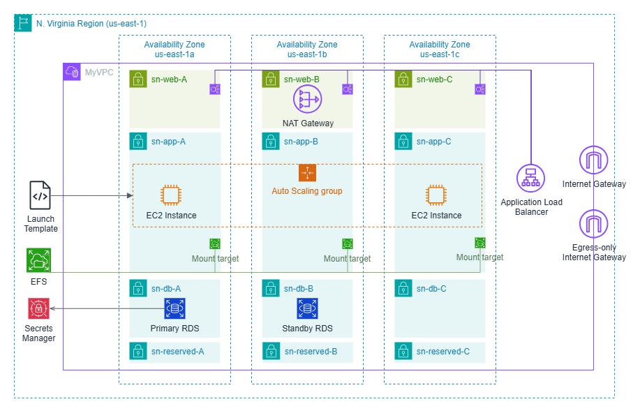

# Highly Available Fault Tolerant AWS Web App
A multi-tiered, highly available, fault-tolerant and scalable WordPress web application deployed on AWS using VPC, EC2, ALB, Auto Scaling, RDS, EFS, CloudFormation, CloudWatch and Secrets Manager.


## Project overview

The implementation is documented in four stages, from the initial infrastructure foundation through application configuration and traffic distribution.

## Architecture



## Implementation guide

The detailed guide preserves the step-by-step process, commands, and screenshots from the original project documentation.

**[Read the full deployment guide](deployment-guide.md)**

## AWS services and technologies

Amazon VPC · EC2 · Application Load Balancer · Auto Scaling · Launch Templates · RDS for MySQL · EFS · IAM · Secrets Manager · CloudFormation · CloudWatch · Linux · Apache · PHP/PHP-FPM · WordPress

## Repository structure

```text
HTA-FT-AW-WebApp/
├── README.md
├── cloudformation/
│   └── base-stack.yaml
├── deployment-guide.md
├── architecture/
│   └── ArchitectureDiagram.png
└── screenshots/
```

## Notes

This repository documents a personal learning and implementation project.

All credentials, secret values, account identifiers, resource ARNs, endpoints, IP addresses, and other information publicly published in this repository have been deleted, teared down or released and are no longer in use.
