# AWS WordPress Deployment – Step-by-Step Implementation Guide

## Navigation

- [Stage 1](#stage-1)
- [Stage 2](#stage-2)
- [Stage 3](#stage-3)
- [Stage 4](#stage-4)


Building a Highly Available WordPress Web Application

In this project, I design and implement a highly available, multi-tier WordPress web application on AWS using various services. The tiered architecture ensures scalability, resilience, and efficient resource management while maintaining security.

Services Used: Amazon VPC, Amazon RDS, Amazon EFS, Amazon EC2, AWS CloudFormation, AWS Secrets Manager, Amazon IAM.

We will set up our web application across multiple tiers (web tier, application logic, and database + reserved tier for future expansion):

The WordPress core, OS, packages and configuration stored on EC2 and EBS will be baked into an AMI.

A Launch Template will use this AMI to automate the instance creation through an Auto Scaling Group which scales based on average CPU consumption.

Blog posts, pages, users, settings and comments will be stored on RDS.

The images, uploads, themes and plugins will be stored on EFS.

Secrets Manager will store the database and application credentials which will be retrieved by EC2 using appropriate IAM roles (Instance Profile).

Elastic Load Balancing will be used for the EC2 target group.

Appropriate least-privilege Security Groups will be assigned to each component.

This architecture will be spread across multiple AZs of the same VPC, with a NAT Gateway, an Egress-only Internet Gateway, and an Internet Gateway.

The base infrastructure (VPC, RDS and EFS) will be deployed through a CloudFormation stack, while the rest is built manually through the console.

## Stage 1 – Base infrastructure in IaC

Deploy CloudFormation stack to create the base VPC, RDS database and EFS file system.

Stack Parameters:

1.  DBName: The WordPress database name.

2.  DBUser: The database master username.

3.  DBVersion: The version of MySQL to use for RDS, default is "8.4.11".

4.  MultiAZ: Choose whether RDS deployment is MultiAZ or not. Set as false by default for cost-saving purposes in this project.

Stack Outputs:

1.  dbendpoint: The RDS Endpoint Address.

2.  DatabaseSecretArn: The ARN of the secret containing our DB credentials.

3.  cwagentconfig: The name of the SSM Parameter containing the configuration for the CloudWatch agent.

The CloudFormation template creates these base resources as follows:

### Create VPC and subnets 

Regionally resilient

First, we choose a CIDR with the following important considerations:

- In a real prod env – avoid overlapping with other CIDRs used by the business including on-prem, partners, vendors.

- Try to avoid commonly used CIDRs such as in the 10.0.0.0/16 range.

- How many regions does the business operate in?

- How many subnets? Think of HA and multi-tier architecture.

Taking into account the above considerations and assuming our business operates in one region – North Virginia, I deployed 3 tiers spread across 3 AZs for HA and chose the VPC CIDR to be 10.18.0.0/16.

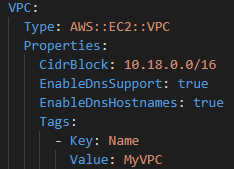

Subnets split as follows:

WEB Public subnet CIDR block in us-east-1a

10.18.0.0/20

WEB Public subnet CIDR block in us-east-1b

10.18.64.0/20

WEB Public subnet CIDR block in us-east-1c

10.18.128.0/20

APP Private subnet CIDR block in us-east-1a

10.18.16.0/20

APP Private subnet CIDR block in us-east-1b

10.18.80.0/20

APP Private subnet CIDR block in us-east-1c

10.18.144.0/20

DB Private subnet CIDR block in us-east-1a

10.18.32.0/20

DB Private subnet CIDR block in us-east-1b

10.18.96.0/20

DB Private subnet CIDR block in us-east-1c

10.18.160.0/20

I added an additional reserved tier for potential future use:

RESERVED Private subnet CIDR block in us-east-1a

10.18.48.0/20

RESERVED Private subnet CIDR block in us-east-1b

10.18.112.0/20

RESERVED Private subnet CIDR block in us-east-1c

10.18.176.0/20

I also created an IPv6 CIDR block:

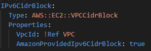

And once that was created, I ensured each subnet is assigned with IPv4 and IPv6 CIDRs on creation, here is the creation of the DB subnet in AZ A for example:

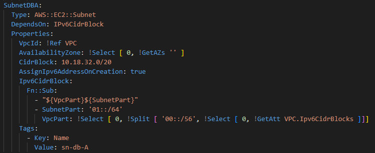

### Create Internet Gateway

Create an Internet Gateway and attach it to our VPC.

Create a Route Table for the web subnets and ensure that once the IGW is attached to the VPC, you add default routes directing traffic to the IGW:

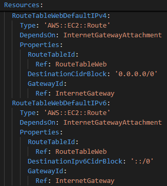

Then attach this RT to all 3 public web subnets.

### Create NAT Gateway and Egress-Only Internet Gateway

To allow outbound IPv4 internet access without exposing private instances to unsolicited inbound connections, we create a NAT Gateway and attach it to a public subnet.

In addition, to allow outbound IPv6 internet access without allowing internet-initiated connections to private subnets we create an Egress Only Internet Gateway and attach it to our VPC.

\*\*note: Ideally in a production environment we want to create at least 2 zonal NATGWs in 2 different AZs for HA (or a regional NATGW), but in this project I created only one zonal NATGW for cost-saving purposes.

Create a Route Table for the private subnets and add default routes directing IPv4 traffic to the NATGW and IPv6 traffic to the Egress-Only IGW.

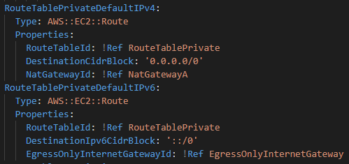

Then attach this RT to the 3 private app subnets, leaving the DB subnets without internet access.

### Create RDS

Create a Security Group for RDS configured with one inbound rule to allow incoming MySQL traffic on port 3306 only from the EC2 Security Group.

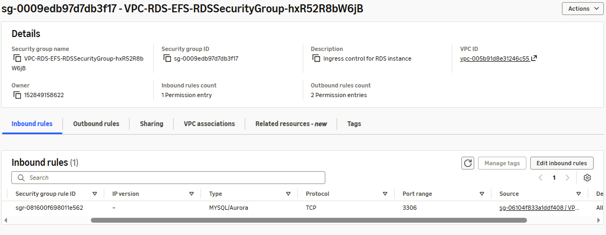

Then we create a subnet group including the 3 DB subnets in which we want our RDS instance/s to be deployed.

Now that we’ve created the security group and the subnet group, we can create the RDS Instance and set the property ManageMasterUserPassword to true to ensure credentials are stored in Secret Manager and password creation and rotation is managed by AWS. We set the MultiAZ, EngineVersion and MasterUsername properties based on the input values of the stack parameters.

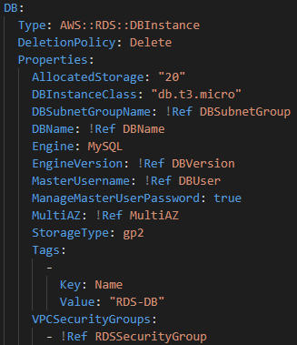

Of course, a MultiAZ DB instance deployment provides data redundancy and minimizes latency spikes during system backups (as backups are taken from the standby instance) improving performance and fault-tolerance.

The default RDS automated backups are enabled (1 Day) and taken from the standby, where the MultiAZ property ensures synchronous replication from the primary instance.

Our DB tier contains 3 subnets in 3 different AZs and all 3 together create our RDS subnet group. This means our primary RDS instance sits in one of these 3 subnets and our standby sits in another.

### Create Instance Profile and default SG for EC2 Instances

Create a Security Group for EC2 instances with one self-reference rule (port range 0 – 65535) and another inbound rule to allow incoming HTTP traffic on port 80 from any source 0.0.0.0/0 (later when we add the ALB, we change the source to be the ALB SG).

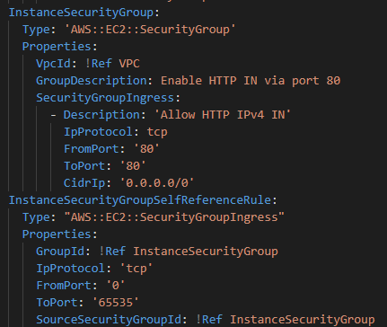

Create an Instance Profile with an IAM role that can be assumed by EC2 and has the following AWS-managed policies attached:

- Full SSM access, so we can configure the instance through Session Manager

- EFS access, to allow the instance to store files on shared storage instead of locally.

- CloudWatchAgent to allow the instance to send detailed logs and metrics to the CloudWatch service.

RAM utilization, swap usage, and filesystem disk space which are not collected by default, will be collected using the agent every 1 minute interval. For these configurations, we create an SSM paramet called "CWAgentConfig" which the agent will use.

### Create EFS

Configure one inbound rule for the EFS Security Group to allow incoming NFS IPv4 traffic on port 2049 only from the EC2 Security Group.

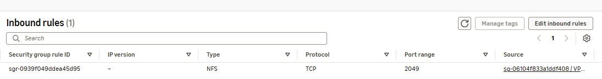

Create an EFS file system and a Security Group for it with one inbound rule to allow NFS traffic (port 2049) from the Instance’s SG. As our EC2 instances must be able to reach an EFS mount target in their Availability Zone, we create 3 mount targets in the 3 app subnets where the EC2 instances will be running from and attach the EFS SG to each of the mount targets.

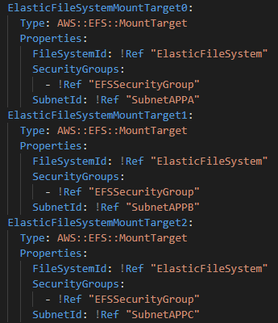


## Stage 2 – Configure EC2 Instance for Custom AMI

In this stage, we want to create an EC2 instance and configure it with WordPress in order to eventually bake it into our custom AMI.

### Create ReadRDSSecret policy

First, we want to make sure our EC2 instance will be allowed to retrieve the RDS DB credentials from Secrets Manager at runtime to avoid hardcoding them. This is where we will use the secret’s ARN from our stack outputs; we navigate to the IAM management console > Policies, and create a customer-managed policy called ReadRDSSecret:
```bash
{
    "Version": "2012-10-17",
    "Statement": [
        {

            "Effect": "Allow",
            "Action": "secretsmanager:GetSecretValue",
            "Resource": [
                "<secret-ARN>"
            ]
        }
    ]
}
```
Then we navigate to the Roles page from the IAM management console, and locate the IAM role created by our stack (it's name should start with the name of our stack). We will attach the ReadRDSSecret policy to this instance role to allow our instances to retrieve the secret:

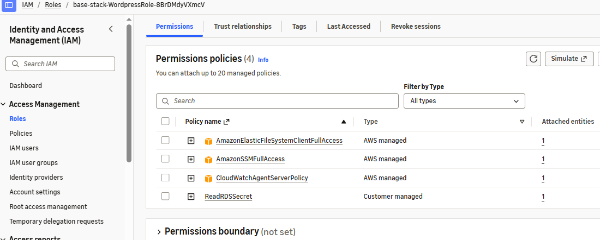

### Create EC2 Instance

Create an EC2 instance using the “Launch an Instance” wizard through the console.

Under Network settings, we choose the VPC created through our stack in the previous step and place the instance in a public subnet for now so that it is accessible through the internet for configuration purposes (later our custom AMI will launch new instances in private subnets only).

Under “Firewall” choose “Select existing security group” to assign the instance the SG created through our stack earlier:

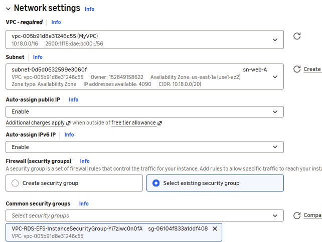

Expand the “Advanced details” section and assign the instance with our instance profile which was also created through our stack earlier:

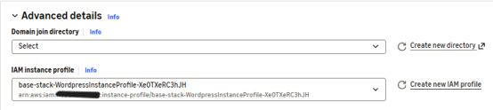

This instance profile ensures the instance will have permissions to access SSM, EFS and CloudWatch.

And lastly, to use the CloudWatch agent we will scroll down to the user data section and add the following commands to install the agent and configure it using the SSM parameter we created in our stack:
```bash
#!/bin/bash

#Install CloudWatch Agent
dnf install amazon-cloudwatch-agent -y

#Create collectd configuration directory and types.db
mkdir -p /usr/share/collectd/
touch /usr/share/collectd/types.db

#Fetch CloudWatch Agent configuration from SSM and start the agent
/opt/aws/amazon-cloudwatch-agent/bin/amazon-cloudwatch-agent-ctl \
-a fetch-config \
-m ec2 \
-c ssm:<My-CWAgentConfig-SSMParameter-Name> \
-s
```
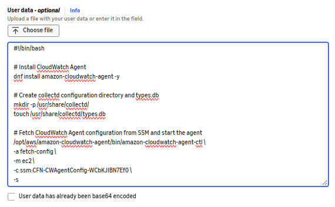

We can easily retrieve the <My-CWAgentConfig-SSMParameter-Name> from the stack outputs.

Once the instance is created, we will connect to the instance through session manager.
Make sure the CWAgent was installed:
```bash
rpm -q amazon-cloudwatch-agent
```
Then verify that the service is running:
```bash
sudo systemctl status amazon-cloudwatch-agent
```
And we can even verify the configuration was fetched from our SSM parameter:
```bash
sudo cat /opt/aws/amazon-cloudwatch-agent/etc/amazon-cloudwatch-agent.toml
```
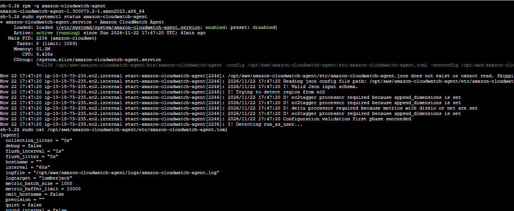


### Manually build WordPress

#### Install packages
As RDS hosts our MySQL database, we don't need a MariaDB server installed on EC2 (no need for the mariadb105-server package), but we still need the client tools and libraries since the EC2 needs to connect to RDS. Therefore, we will use the mariadb105 package as the MySQL client.

In addition to the MySQL client, we will install Apache for the web server and use PHP-FPM to run the WordPress php code and query our database for posts and settings.

Install system software including Apache, PHP and its necessary extensions, MySQL client, Composer and utilities:
```bash
sudo dnf install -y \\

httpd \\

php \\

php-mysqlnd \\

php-fpm \\

php-json \\

php-mbstring \\

php-xml \\

php-gd \\

php-curl \\

php-zip \\

php-intl \\

mariadb105 \\

amazon-efs-utils \\

nmap-ncat \\

curl \\

unzip \\

git \\

composer
```
Enable and start Apache and PHP (start services now and also configure them to start automatically on boot):
```bash
sudo systemctl enable httpd
sudo systemctl start httpd
sudo systemctl enable php-fpm
sudo systemctl start php-fpm
```
Check that Apache is running:
```bash
sudo systemctl status httpd
```
#### Mount EFS

Now we will check the file systems:
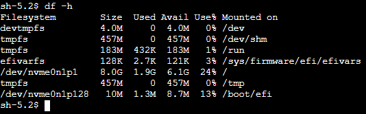

We want to mount our EFS file system onto the directory which WordPress uses to store uploads, plugins and themes called wp-content. Therefore we will create the directory and mount our file system to it by adding it to our mount configurations in the fstab to also ensure EFS persists across reboots (and later through new launches of the baked AMI):
```bash
sudo mkdir -p /var/www/html/wp-content
echo "<FS-ID>:/ /var/www/html/wp-content efs _netdev,tls,iam 0 0" | sudo tee -a /etc/fstab
sudo mount -a -t efs defaults
```
Now we can see that our filesystem is mounted:

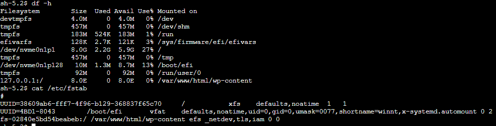

#### Install WordPress

Now we want to install WordPress. Using the below commands we download the latest WordPress release into a temporary folder:
```bash
cd /tmp
sudo curl -LO https://wordpress.org/latest.tar.gz
sudo tar -xzf latest.tar.gz
```
Then we copy the WordPress files to Apache's document root (except for the directory which we already created and mounted EFS on):
```bash
sudo rsync -av /tmp/wordpress/ /var/www/html/ --exclude=wp-content
```
To finish, we copy the WordPress content directories to EFS:
```bash
sudo cp -a /tmp/wordpress/wp-content/. /var/www/html/wp-content/
```
Next, we set the ownership and permissions:

- Apache/PHP-FPM needs permission to read the wp files to execute WordPress.

- The EFS root directory should also allow the Apache user to write.

This means that generally the administrator (root) should control modifications (specifically wp-config.php where Apache needs read-only access), except for the wp-content directory which requires Apache to write.

We set the owner of the files to root, and the group associated with the files to Apache, then change the owner to Apache only on the EFS directory:
```bash
sudo chown -R root:apache /var/www/html
sudo find /var/www/html -type d -exec chmod 755 {} \;
sudo find /var/www/html -type f -exec chmod 644 {} \;
sudo chown apache:apache /var/www/html/wp-content
```
The final permissions will look like this:

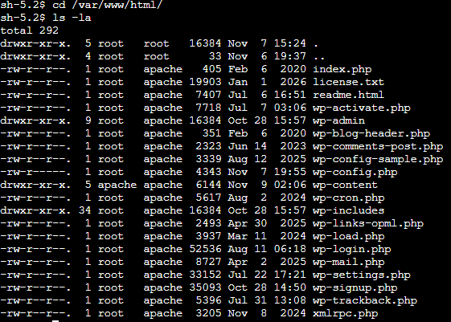

#### Prepare RDS

We want to create a dedicated WordPress application user. First we'll use the MySQL client we installed to connect to our RDS endpoint with our master credentials:
```bash
mysql -h <RDS_ENDPOINT> -P 3306 -u admin -p
```
Here we enter our master password, which was automatically created by AWS through our stack and is stored as a secret in Secrets Manager. Once connected to the RDS endpoint, we create a wordpress application user:
```bash
CREATE USER 'wordpress_app'@'%'
IDENTIFIED BY 'MY-STRONG-RANDOM-PASSWORD';
```
Then grant it with permissions on the wordpressDB (Which was already created earlier through our stack):
```bash
GRANT ALL PRIVILEGES ON wordpressDB.*
TO 'wordpress_app'@'%';
```
In the Secrets Manager console, we store the credentials of the application user as key/value pairs in Json format:
```bash
{

"username": "wordpress_app",
"password": "MY-STRONG-RANDOM-PASSWORD"

}
```
We add the ARN of this secret to our ReadRDSSecret policy attached to the instance role under the “Resource” section:

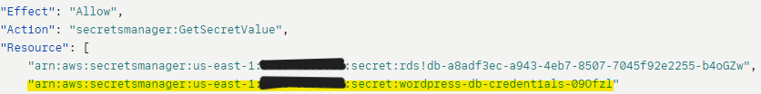

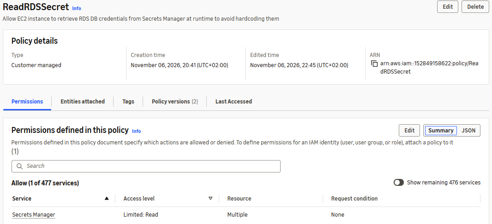

#### Configure wp-config.php

Since WordPress itself doesn't natively retrieve credentials from Secrets Manager, we'll use the AWS SDK for PHP (which automatically uses the EC2 instance's IAM role credentials):

Create a separate directory for the SDK:
```bash
sudo mkdir -p /opt/aws-sdk-php
```
Install the SDK using Composer:
```bash
cd /opt/aws-sdk-php
sudo composer require aws/aws-sdk-php
```
After the SDK and its dependencies are installed onto /opt/aws-sdk-php/vendor/, we make sure Apache has read access to these files:
```bash
sudo chmod -R a+rX /opt/aws-sdk-php
```
For maximum security we need to avoid hardcoding credentials into the wp-config.php file, aiming for the following architecture:

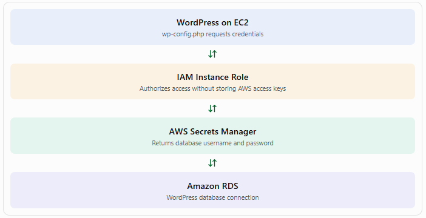

WordPress wp-config.php should contain the RDS connection details such that WordPress can retrieve them directly from Secrets Manager using the AWS SDK for PHP.

For production, we would also implement caching of retrieved credentials to avoid making a Secrets Manager API request on every WordPress request, and of course make sure the cache expires and refreshes appropriately when credentials rotate.

First, we create the WordPress configuration file and copy the provided sample one into it:
```bash
cd /var/www/html
sudo cp wp-config-sample.php wp-config.php
```
Open the file to edit it:
```bash
sudo nano /var/www/html/wp-config.php
```
At the beginning of the file, after the opening \<?php tag, we perform the below modifications to use the AWS SDK for PHP, retrieve the db credentials from Secrets Manager, and adjust the database settings template replacing the placeholders with our db name, retrieved user, retrieved password and host endpoint:
```bash
require_once '/opt/aws-sdk-php/vendor/autoload.php';

use Aws\SecretsManager\SecretsManagerClient;

$client = new SecretsManagerClient([
    'version' => 'latest',
    'region'  => 'us-east-1'
]);

$result = $client->getSecretValue([
    'SecretId' => 'wordpress-db-credentials'
]);

$credentials = json_decode($result['SecretString'], true);

if (!isset($credentials['username'], $credentials['password'])) {
    throw new RuntimeException('Database credentials are missing.');
}

// ** Database settings - You can get this info from your web host ** //
/** The name of the database for WordPress */
define( 'DB_NAME', 'wordpressDB' );

/** Database username */
define( 'DB_USER', $credentials['username'] );

/** Database password */
define( 'DB_PASSWORD', $credentials['password'] );

/** Database hostname */
define( 'DB_HOST', 'base-stack-db-cnutvsnre2x0.c0hsgi66gvsf.us-east-1.rds.amazonaws.com' );

/** Database charset to use in creating database tables. */
define( 'DB_CHARSET', 'utf8mb4' );

/** The database collate type. Don't change this if in doubt. */
define( 'DB_COLLATE', '' );
```
Press Ctrl+O, then enter, then Ctrl+X to save and exit.

Now, we generate WordPress security keys and salts:
```bash
curl -s https://api.wordpress.org/secret-key/1.1/salt/
```
We copy the generated definitions into wp-config.php, replacing the existing placeholder authentication keys and salts.

Then, we set the permissions on the newly created wp-config.php file to be the same as the rest of the files (as we set earlier):
```bash
sudo chown root:apache /var/www/html/wp-config.php
sudo chmod 640 /var/www/html/wp-config.php
```
Lastly, we will copy the public IP address of our instance and paste it into our web browser to build a sample blog and upload some images and files, utilizing both our RDS database and EFS file system.

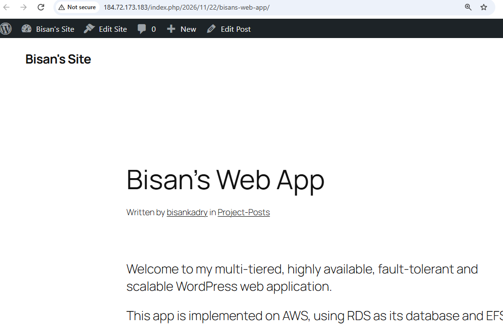


## Stage 3 - Enable elasticity via an ASG & ALB

### Bake AMI

To automate the build, we want to bake our instance configurations into an AMI that a Launch Template will use.

In the EC2 console, we select the instance that we made earlier and click Actions \> Image and templates \> Create Image.

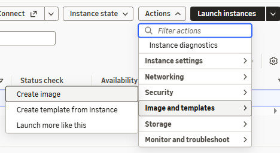

Once our custom AMI (Golden Image) creation has been completed and its status is "Available", we terminate the instance.

Now our AMI has captured the EC2 instance's EBS-backed files which we’ve worked on, including:

\- WordPress core files including the configurations we’ve changed in wp-config.php such as the connection to RDS and the security salts.

\- Apache and PHP-FPM installation and configuration.

\- AWS SDK for PHP.

\- EFS mount point in the /etc/fstab.

### Create ALB (Application Load Balancer)

Now, we will configure and set up an ALB to handle load balancing HTTP requests and forward them to our target group of web servers running on EC2 instances. The use of an LB abstracts connections from individual instances making architecture more elastic.

Through the “Create Load Balancer” wizard we will also create the ALB’s security group and our target group.

Through the EC2 management console we navigate to the Load Balancers and click on “Create Load Balancer” then choose Application Load Balancer as the type.

I named it Web-ALB, make sure the Scheme is set to internet-facing, and select Dualstack for the IP address type:

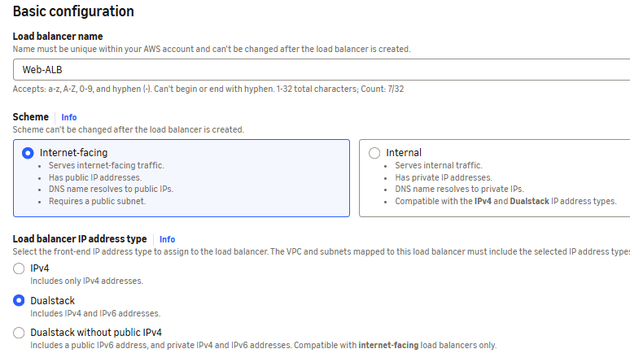

Under Network mapping, we choose our VPC (which was created by our stack in the beginning) and select all 3 AZs making sure the chosen subnet in each AZ is the public one:

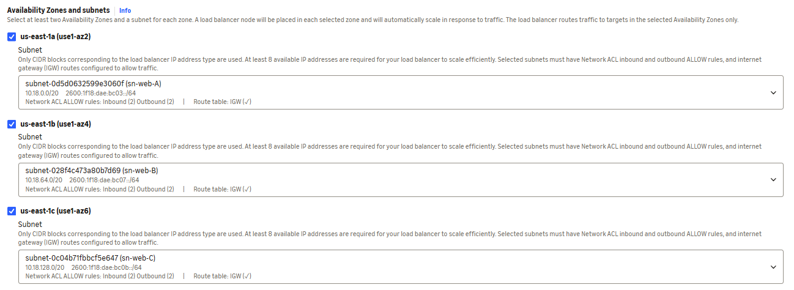

Our ALB spanning 3 AZs (all 3 public web subnets) increases the fault-tolerance of our architecture.

Under Security groups we click on “Create security group” and add inbound rules accepting HTTP traffic in, on port 80 from any source – one rule for IPv6 and one for IPv4 (from ::/0 and 0.0.0.0/0 respectively). In real production environments we would also configure a certificate through ACM to allow HTTPS traffic in through port 443 for at-flight security.

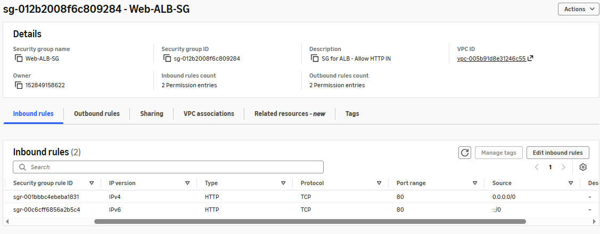

Once the security group is created, we return to the “Create load balancer” page and assign our Web-ALB-SG to the ALB we are creating instead of the default SG.

Under Listeners and routing, we keep the protocol as HTTP and Port as 80 and for the Default action, we want the “forward to target groups” selected. We click on “Create target group”, and select "Instances" for the target type, I named the group Web-TG and selected our VPC leaving everything else as default.

Once the target group is created, we go back again to the “Create load balancer” page and select our Web-TG.

### Create LT (Launch Template)

Now that we have the ALB created, we want to move on to creating a Launch Template which will automate the build.

First, let’s change the inbound rule of our instances security group to allow HTTP traffic from the ALB-SG only, instead of the current rule allowing HTTP from any source, to abide by the least-privilege principle.

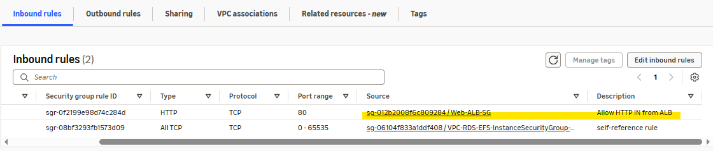

Now, still through the EC2 management console where we created the ALB, we navigate to the Launch Templates and click on “Create launch template”.

I chose the name web-lt, and since we want to use this LT within an ASG, we check the “Auto Scaling guidance” checkbox:

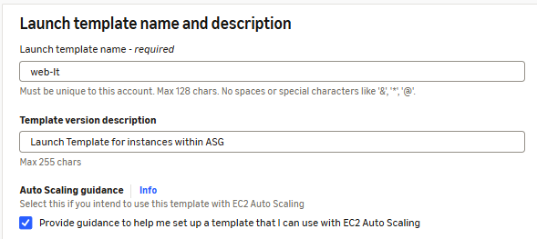

Under “Application and OS Images” we navigate to “My AMIs” and choose our custom AMI:

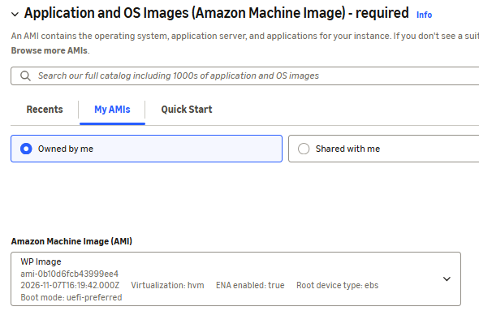

For “Instance type” I chose t3.micro to stay within the free tier.

Then under Network settings, we want to select an existing security group and choose the one we created through our CloudFormation stack:

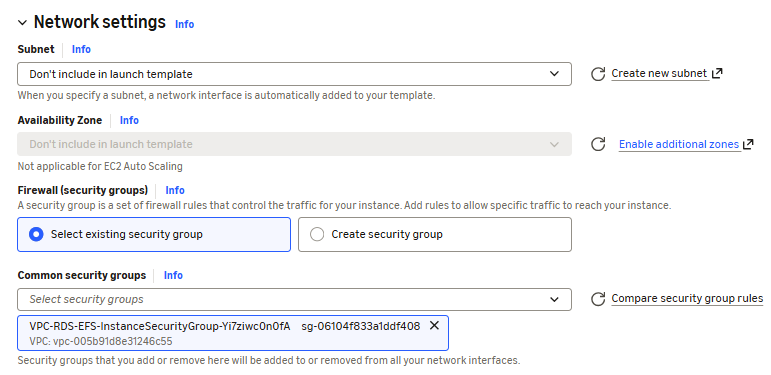

Lastly, we expand the “Advanced details” section and choose the Instance profile which we have also created in the beginning through our stack:

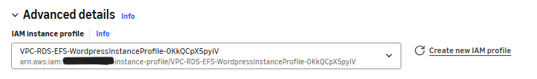

### Create ASG (Auto Scaling Group)

Still through the EC2 console, this time we navigate to the Auto Scaling Groups and click on “Create Auto Scaling group”.

I named it Web-ASG, and then under “Launch template” we select the LT we just created.

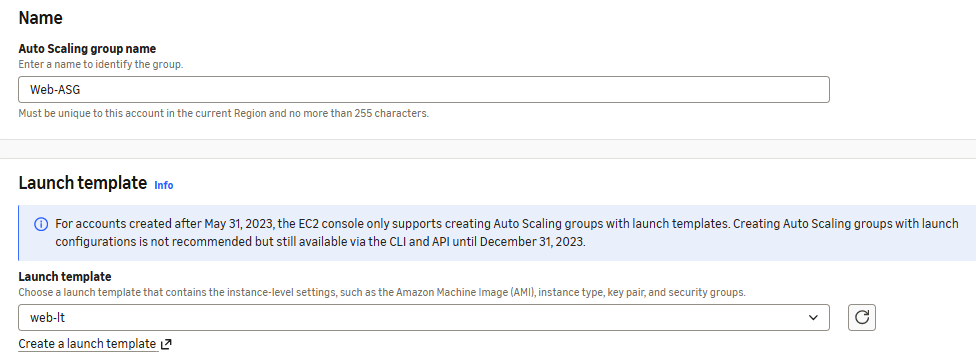

Under the Network section in the next step, we want to select our VPC and choose the 3 app subnets which we want our instances launched into:

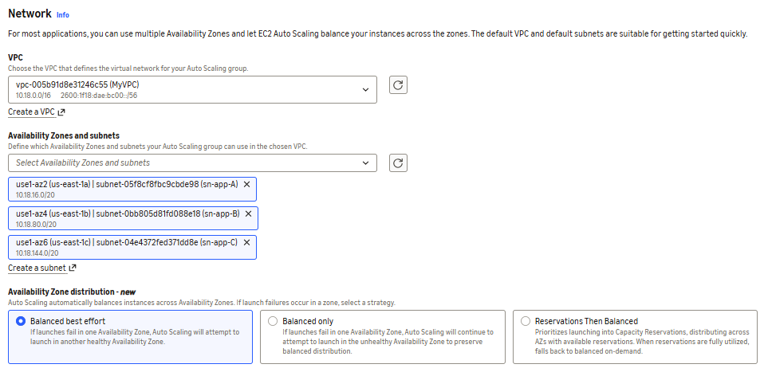

In the next step under Load Balancing, we want to use an existing LB and select the Web-ALB we created earlier along with the Web-TG we created with it:

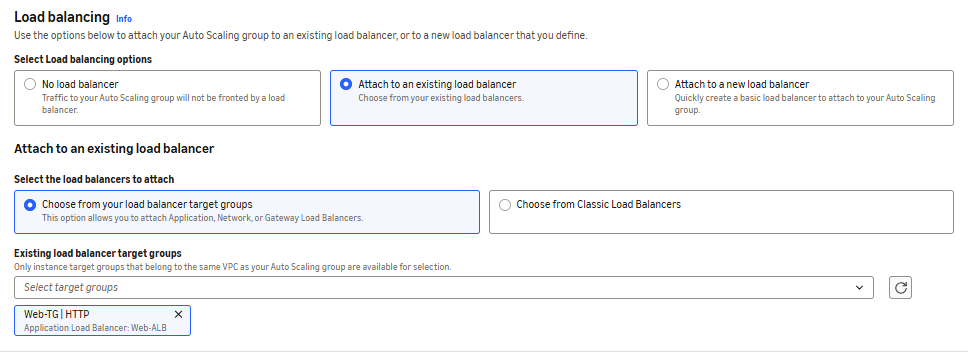

Under “Health checks”, in addition to the EC2 health checks which are always enabled, we will also include the ELB health checks (HTTP on port 80) by checking its checkbox:

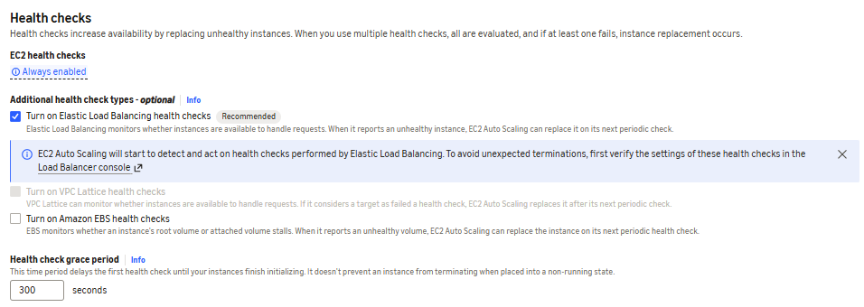

In the next step, for our small project we set desired capacity (number of instances) at 1, and scaling limits 1-3 with a target tracking policy aimed at maintaining an average CPU utilization of 30%:

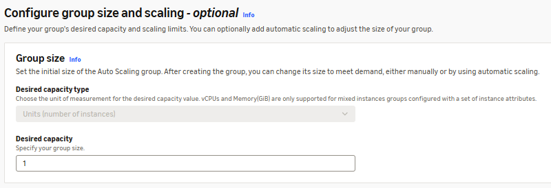

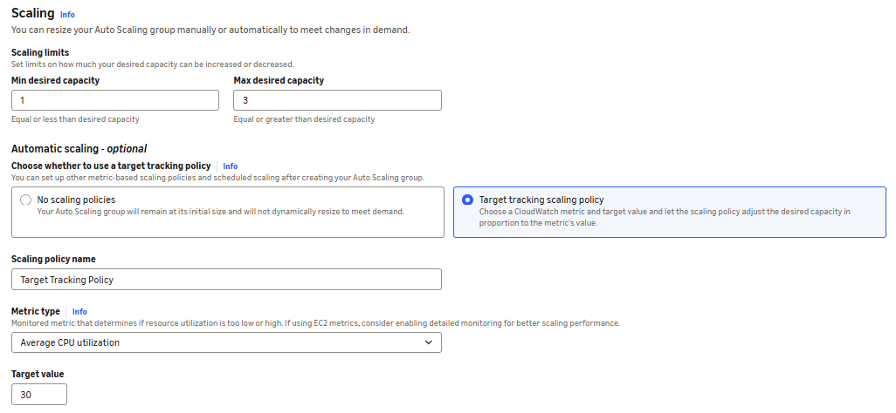

Setting minimum capacity at 1 also acts as a fault-tolerance method as this forces the creation of a new instance to reach minimum capacity of 1 if the only instance in the group fails, and this is of course in addition to the primary goal of autoscaling which is improving performance based on load.

In the same step, we want to also check the monitoring checkbox under “Additional settings” as this allows CloudWatch to see the group metrics that can determine the status of ASGs:

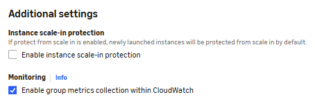

Lastly, we want to tag new instances created by the ASG with the name ASG-Web-Instance:

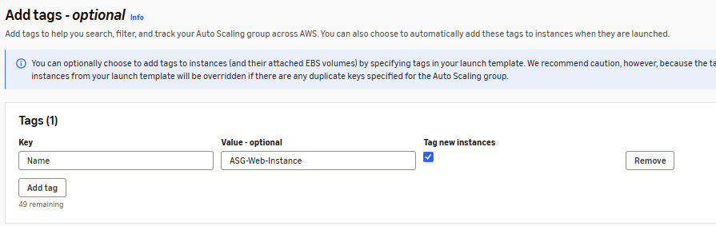

Now once the ASG creation is complete, we can start seeing the instance being launched automatically in the “Instances (running)” page with the tag we added:

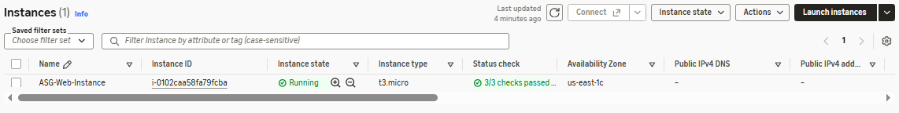

At this point, we’ve ensured that new instances are created automatically by the ASG are configured with the same:

\- RDS endpoint and database name.

\- EFS file system and mount point.

\- Secrets Manager secret and appropriate IAM permissions.

\- Security groups and network access.

## Stage 4 - Fix WordPress configurations (hardcoded WPHOME)

Challenge:

Our AMI is configured in a way in which WordPress relies on WP_HOME and WP_SITEURL being the localhost and using the public IP address of the EC2 instance (which was is the public IP address that was assigned to the instance we created and baked our AMI from) so now our blog isn’t working properly as it tries reaching that IP which is no longer used.

Since we’ve added an ALB to our infrastructure and our instances currently sit in a private subnet instead of a public one, we need to fix the WP configurations accordingly.

1.  Install WP-CLI to update any reference of the public IP address of the EC2 created earlier to the ALB DNS name (or our custom domain that points to the LB if we were using one).
```bash
sudo -u apache wp search-replace \
'http://<OLD_EC2_PUBLIC_IP> ' \
'http://<ALB_DNS_NAME>' \
--all-tables-with-prefix \
--skip-columns=guid \
--dry-run \
--path=/var/www/html
```
Check the wp-config.php file and ensure WP_HOME and WP_SITEURL point to the Web-ALB:
```bash
define('WP_HOME', 'http://<ALB_DNS_NAME>');

define('WP_SITEURL', 'http://<ALB_DNS_NAME>');
```
Then, the same way we created an image from our EC2 instance earlier, we bake a new AMI of the current instance to include the above fixes.

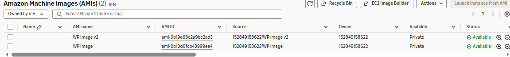

Next, we create a new version of the Launch Template referencing the new AMI and set our Web-ASG to use the new Launch Template version – either by setting the new LT version as default and having the ASG use the default, or by ensuring the ASG uses the latest LT version.

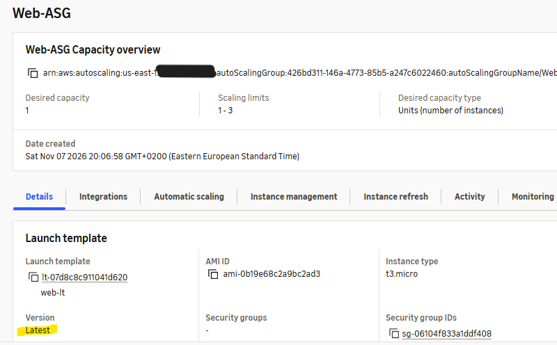

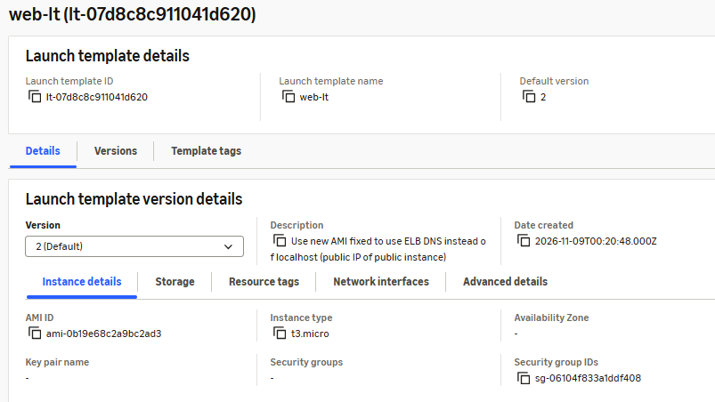

To ensure that all of our EC2 instances use the new AMI, we will start an instance refresh through the “Instance Refresh” tab of our ASG. As this is a personal small project, we can compromise availability in order to control costs and choose “Terminate and launch” for the instance replacement method with a minimum healthy percentage of 0% (allow our app to be down during the process). In a production environment where availability is a top priority, we would choose the “Launch before terminating” replacement method where the minimum healthy percentage is 100%, or alternatively perform the instance refresh through a low-activity window and set the minimum percentage to a percentage we can tolerate.

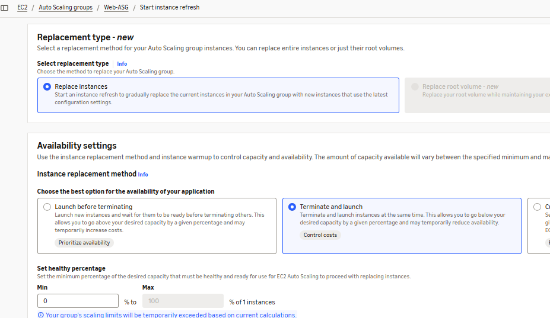

After the instance refresh is complete, we can navigate to the DNS name of our ELB to make sure our blog and media uploads are still available:

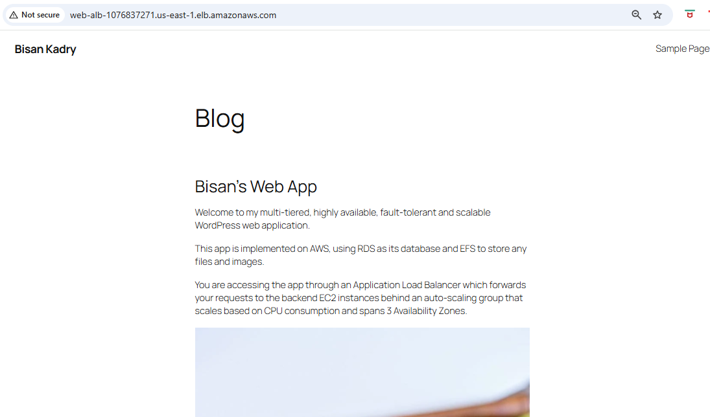

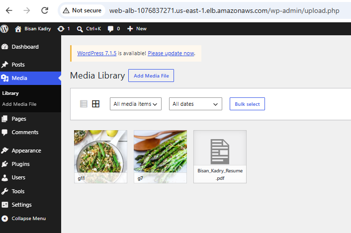
